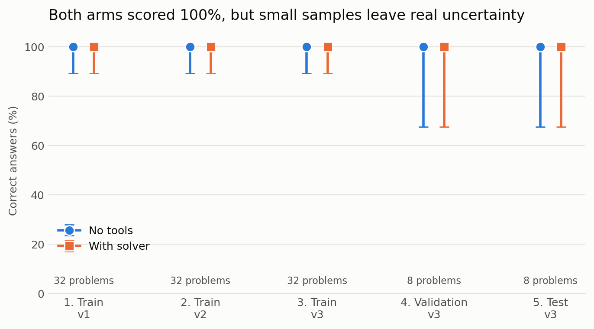
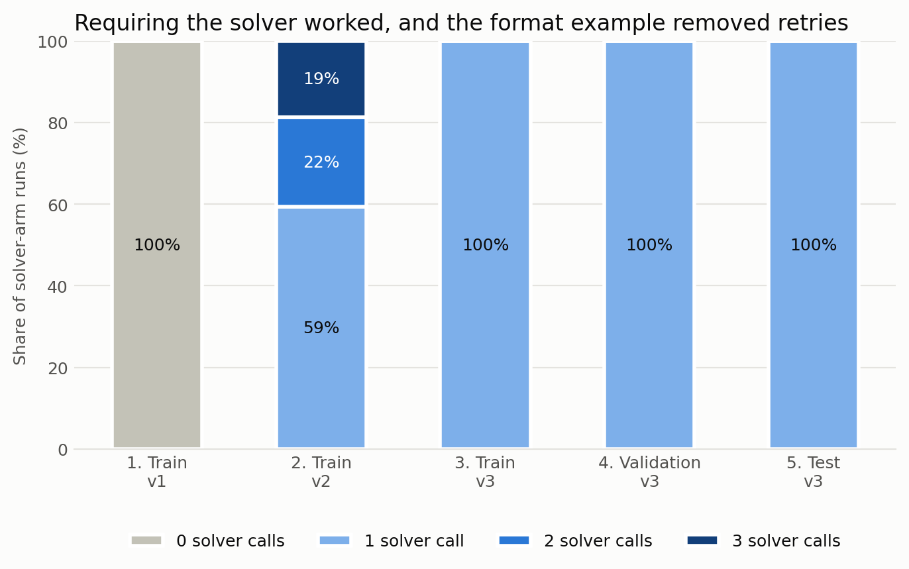
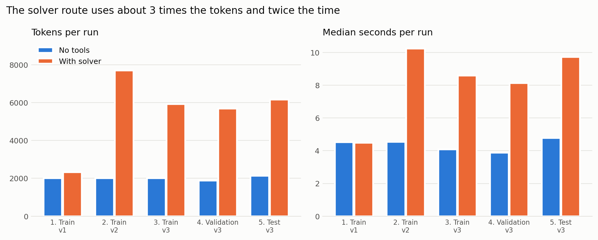

# Claude Code study: solving surgery scheduling directly or through a solver

**Date:** 30 October 2026. **Model:** `claude-opus-5-5` at `high` effort through Claude Code 2.1.314.
**Data:** the 48-problem `arrival-deadline-v1` set. **Status:** preliminary. The team has not yet agreed the prompts, budget or model.

## The result in one minute

Claude got **every problem right both ways**, including 8 problems held back until the end. That does **not** show the two approaches are equally good. The problems are too easy to separate them.

What the study did show:

1. **Claude skips an optional solver.** Offered the solver, it made 0 calls in 32 runs. It only used it when told to.
2. **Its translation was accurate.** Once required to use the solver, its final submission matched the true problem in all 96 runs across iterations 2 to 5. Some v2 runs needed retries to get there.
3. **Its early failures came from the solver's format, not from misreading the problem.** A vague tool description caused 19 errors. One worked example removed them all.
4. **The solver route costs more.** On the test problems it used about 3 times the tokens and 2 times the time, for no extra correct answers here.

## Words used in this report

| Word | Plain meaning |
|---|---|
| Arm | One way of solving. **No tools**: Claude answers alone. **With solver**: Claude translates the problem and a solver program finds the answer. |
| Solver (CSP) | A program that searches for a schedule meeting every rule. CSP means constraint satisfaction problem. |
| Translation | Claude rewriting the English problem as structured data for the solver. |
| Feasible / infeasible | A valid schedule exists / no valid schedule can exist. |
| Certificate | A short proof that a problem is impossible, here naming two surgeries that cannot both fit. |
| Gold | The true answers. Claude never sees these. |
| Train, validation, test | Three separate groups of problems: one to improve the prompt, one to check it, and one for the final exam. |
| Token | The unit AI usage is measured in, roughly three-quarters of a word. |
| 95% interval | The range the true success rate plausibly falls in, given how little data there is. |

## What "training" means here

**Claude was not trained, and nothing about the model changed.** It is a finished model. What improved was the **prompt**, the instructions we give it. So the loop was:

1. Run the current prompt on the 32 training problems.
2. Read what went wrong, and write down the limitations.
3. Change one thing in the prompt.
4. Repeat until the training failures are gone, then **freeze** the prompt.
5. Check on 8 validation problems, then sit the final exam on 8 test problems.

The test problems were not used until the prompt was frozen. Otherwise we would be marking Claude on questions we had tuned it for. This loop works for any later prompt or dataset.

Each problem ran separately, with a fresh session in an empty folder, all of Claude Code's own tools off and user settings ignored. Without that, the no-tools arm could have written its own solver or read the answer file. An independent checker marked every answer against the true problem.

## Overall results

| Iteration | Arm | Runs | Correct | Solver calls per run | Solver errors | Exact translations | Median time (s) | Tokens per run |
|---|---|--:|---|--:|--:|---|--:|--:|
| 1. Train, v1 | No tools | 32 | 32/32 (100%) | 0.00 | 0 | n/a | 4.5 | 2,008 |
| 1. Train, v1 | With solver | 32 | 32/32 (100%) | 0.00 | 0 | 0/32 | 4.5 | 2,316 |
| 2. Train, v2 | No tools | 32 | 32/32 (100%) | 0.00 | 0 | n/a | 4.5 | 2,007 |
| 2. Train, v2 | With solver | 32 | 32/32 (100%) | 1.59 | 19 | 32/32 | 10.2 | 7,692 |
| 3. Train, v3 | No tools | 32 | 32/32 (100%) | 0.00 | 0 | n/a | 4.1 | 2,003 |
| 3. Train, v3 | With solver | 32 | 32/32 (100%) | 1.00 | 0 | 32/32 | 8.6 | 5,916 |
| 4. Validation, v3 | No tools | 8 | 8/8 (100%) | 0.00 | 0 | n/a | 3.9 | 1,880 |
| 4. Validation, v3 | With solver | 8 | 8/8 (100%) | 1.00 | 0 | 8/8 | 8.1 | 5,676 |
| 5. Test, v3 | No tools | 24 | 24/24 (100%) | 0.00 | 0 | n/a | 4.8 | 2,130 |
| 5. Test, v3 | With solver | 24 | 24/24 (100%) | 1.00 | 0 | 24/24 | 9.7 | 6,159 |

"Exact translations" compares Claude's final solver submission with the true problem, ignoring only the order items are listed in. It is 0/32 in iteration 1 because no translation was submitted, not because translations were wrong.



**How to read this.** The dots are the score and the lines are the uncertainty. Both arms are at 100% everywhere, so there is no winner. With only 8 test problems, the true rate could plausibly be as low as 68%. Across all 48 distinct problems, the lower bound for each arm under prompt v3 rises to about 93%.



**How to read this.** This is the clearest change in the study. Grey is the solver being ignored. Dark bars are retries after the solver rejected a submission. By v3, every run needed exactly one call.



**How to read this.** Blue is flat because the no-tools prompt never changed. Orange shows the extra price of the solver route, and how the format example brought it down.

## Iteration by iteration

### Iteration 1: train, prompt v1 (baseline)

**Changed:** nothing. The solver was offered but optional.

**Evaluation:** 32/32 in both arms, with 0 solver calls.

**Meaning:** the two arms behaved the same, so this run says nothing about translation. Scoring alone would have hidden that. The with-solver score here must not be reported as a solver result.

**Limitations:**
- Translation was not tested at all.
- A perfect score left no failures to learn from.
- One attempt per problem cannot show how consistent Claude is.

### Iteration 2: train, prompt v2 (solver required)

**Changed:** the solver arm must call the solver. The no-tools text stayed identical.

**Evaluation:** 32/32 in both arms, and all 32 final translations were exact. However, 13 of the 32 runs needed retries, with 19 solver errors in total. Tokens per run rose to 7,692.

**Meaning:** there were two kinds of error. 14 were "malformed instance", such as writing a calendar as `[[300,314]]` instead of `[[[300,314]]]`. 5 were a missing `schema_version`. Claude had the facts right and the format wrong, because the tool description is vague about both.

**Limitations:**
- The success score hides the retries. If retries were not allowed, some of these runs would have failed.
- Solver errors are a fault of the tool description as much as of Claude.

### Iteration 3: train, prompt v3 (format example)

**Changed:** added one worked example of the format, using made-up numbers from no dataset problem.

**Evaluation:** 32/32, solver errors fell from 19 to 0, and tokens per run fell 23% to 5,916.

**Meaning:** the explanation from iteration 2 was right. With no failures left on the training problems, v3 was frozen. This is the only clear causal finding, and it rests on one before-and-after comparison.

**Limitations:**
- With nothing left to fix, more tuning would have been pointless.
- The example could shape Claude's translations in ways that a harder dataset might expose.

### Iteration 4: validation, frozen v3

**Changed:** new problems, same prompt.

**Evaluation:** 8/8 in both arms, 8/8 exact translations and 0 solver errors.

**Meaning:** v3 held up on problems it was not adjusted for, so the training results were not just a product of tuning.

**Limitations:**
- 8 problems is very few: 2 for each of the 4 themes, half of them solvable.
- These problems come from the same generator, so they are not really a different kind of problem.

### Iteration 5: test, frozen v3 (final exam)

**Changed:** nothing. Each of the 8 test problems ran 3 times.

**Evaluation:** 24/24 in both arms and 24/24 exact translations. The arms never disagreed, so the paired statistical test has nothing to work with (p = 1.0).

| Problem theme | No tools | With solver |
|---|---|---|
| Eligible room bottleneck | 6/6 (100%) | 6/6 (100%) |
| Fixed surgeon contention | 6/6 (100%) | 6/6 (100%) |
| Room contention | 6/6 (100%) | 6/6 (100%) |
| Tight windows | 6/6 (100%) | 6/6 (100%) |

| Check on the test answers | Result |
|---|---|
| Same answer on all 3 repeats | 16 of 16 problem-and-arm combinations |
| Extra tokens for the solver route | About 2.9 times |
| Extra time for the solver route | About 2.0 times |

**Meaning:** for problems this small, the no-tools route gives the same correct answers for about a third of the tokens. That conclusion only applies to problems like these.

**Limitations:**
- Repeats gave identical answers, so the 24 runs are really 8 pieces of evidence. The charts count them as 8.
- The test set is too small to detect anything but very large differences.

## Is 100% believable?

Three explanations were checked:

| Explanation | Test | Finding |
|---|---|---|
| The marking is broken | Tampered with recorded answers from all five iterations in 5 ways, such as moving a surgery past its deadline | The checker rejected **all 640** tampered answers. The marking works. |
| Answers leaked | Empty working folder, no tools, separate answer file, and Claude reports no tools | No leak found. |
| The problems are too easy | Measured the dataset | **Yes.** See below. |

**Why the problems are too easy:**
- Each has only 2 or 3 surgeries. A brute-force check examines a median of 17 arrangements, and 88 at most.
- **The proof is given away.** All 24 impossible problems use the pair A and E, and that exact pair appears in the example inside the problem text. Claude still had to decide which problems were impossible, but writing the proof was never a real test.
- The wording is rigid. A simple pattern-matching script can already translate it perfectly, so exact translation is a low bar here.
- None of the problems use gaps between surgeries, and each room or surgeon has at most one time window a day, so the harder rules were never tested.

## Limitations of the whole study

| Limitation | Why it matters |
|---|---|
| Problems are too easy | The main question remains unanswered. |
| Small test set, and all 48 come from one generator | Results do not carry over to real or larger scheduling problems. |
| Synthetic, tightly worded text | Real requests are messy and ambiguous, and this tells us nothing about them. |
| The solver is the project's simple search program, not OR-Tools | Results say nothing about a production solver. Here it only had tiny problems. |
| One model at one effort setting | Other models or lower effort may behave differently. |
| Retries count as success | The score does not show how many attempts were needed. |
| Token cost in dollars is unreliable | Dollar figures varied with caching: the same no-tools prompt cost $0.60 once and $0.28 another time. This report compares tokens instead. |
| The team has not approved the setup | The docs ask the team to agree the prompts, budget and model before real runs. |

The 15-problem Tier A set was **not** used. Its documentation requires team approval before any model evaluation.

## What to do next

Claude can already solve this dataset, so more prompt tuning won't help. The study needs harder problems, in this order:

1. **Get team agreement** on these prompts and on using Tier A.
2. **Make the problems harder and verify their answers independently.** Use more surgeries, gaps and calendars, and vary which surgeries cause the conflict. Keep increasing size until no-tools starts failing. That point is the most valuable result this project can report.
3. **Remove the A and E giveaway** from the problem text.
4. **Add less tidy wording**, to give translation a real test.
5. **Swap in OR-Tools** once harder problems exceed the simple solver.

## Reproducing this study

Prompts are in `study/prompts.py`. The runs and metadata for each iteration are saved in `study/results/<iteration>/`. Each `meta.json` records the model, prompt hash, commit and date. Existing results are never overwritten.

```bash
python3 -m unittest discover -s tests                      # no model calls
python3 -m study.run_iteration --iteration my-run --split train --prompt v3 --budget 5
python3 -m study.report                                    # rebuilds tables and charts; needs matplotlib
```

| Iteration | Arm runs | Estimated cost at list price (USD) |
|---|--:|--:|
| Smoke test | 4 | 0.07 |
| 1 | 64 | 1.25 |
| 2 | 64 | 2.67 |
| 3 | 64 | 2.03 |
| 4 | 16 | 0.56 |
| 5 | 48 | 1.13 |
| **Total** | **260** | **7.71** |

## AI disclosure for the report

The course requires you to state what AI contributed. The study code, prompts, charts and this document were produced by Claude Code, under a team member's direction. The model under test is also a Claude model. Review and understand this work before submitting any of it as your own.
