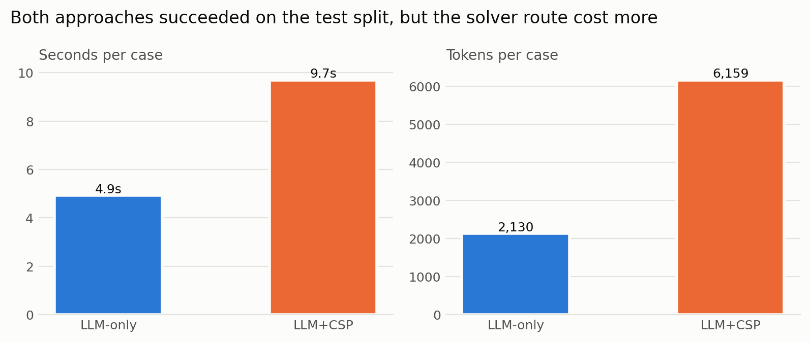

# Claude scored under the shared evaluation framework

**Status:** preliminary, for team review. These numbers re-score runs recorded before the framework was agreed. No new model calls were made.  
**Rulebook:** [`evaluation-framework.md`](evaluation-framework.md).  
**Rerun:** `python3 -m study.framework_report` (needs matplotlib, makes no model calls).

## The short answer

- **Harder problems, Claude alone:** 98 of 100 were correct and backed by evidence.
- **48-case pilot, final test:** Claude alone and Claude with the solver both got 24 of 24, so the pilot can't show that either is better.
- **Cost on that test:** the solver route used about 2.9 times the tokens and 2 times the time.

The numbers match our earlier reports, because the old "fully correct" measure means the same as the framework's "evidence-backed success". The framework adds stricter reliability reporting, and it exposed one thing we must disclose: see "Runs that were replaced".

## What each measure means

| Measure | Plain meaning |
|---|---|
| Evidence-backed success | The answer was right **and** the independent checker accepted its schedule or proof. This is the headline. |
| Feasible-schedule success | On solvable problems, the schedule passed every rule. |
| Certified-infeasible success | On impossible problems, the proof passed the checker. |
| Infeasible decision | On impossible problems, Claude said "impossible", even without a good proof. Diagnostic only. |
| Status agreement | The yes/no answer matched, whether or not the evidence was good. |
| UNKNOWN | No answer was given, including when time ran out. |
| Parse errors | The reply couldn't be read. |

Every planned run stays in the denominator, so a failure can't quietly disappear.

## Pilot: the framework's main table

This is the held-out test split: 8 problems, each run 3 times with the frozen v3 prompt. CSP-on-gold gives the solver the correct problem directly, and it's deterministic, so it ran once per problem. The solver in the LLM+CSP and CSP-on-gold columns is the project's simple search.

| Measure | LLM-only | LLM+CSP | CSP-on-gold |
|---|--:|--:|--:|
| Evidence-backed success | 24/24 | 24/24 | 8/8 |
| Feasible-schedule success | 12/12 | 12/12 | 4/4 |
| Certified-infeasible success | 12/12 | 12/12 | 4/4 |
| Infeasible decision (diagnostic) | 12/12 | 12/12 | 4/4 |
| Status agreement | 24/24 | 24/24 | 8/8 |
| UNKNOWN | 0/24 | 0/24 | 0/8 |
| Parse errors | 0/24 | 0/24 | 0/8 |
| Timeouts | 0/24 | 0/24 | 0/8 |
| Provider errors | 0/24 | 0/24 | 0/8 |
| Tool or solver errors | 0/24 | 0/24 | 0/8 |
| Seconds per case (mean) | 4.9 | 9.7 | 0.0001 |
| Tokens per case (mean) | 2,130 | 6,159 | 0 |

**What it means:** both approaches were perfect, so the only difference is cost. The solver itself took under a millisecond per case, so the extra time comes from Claude writing out the translation and then its final answer. Translating never went wrong: all 64 v3 translations across the splits matched the intended problem exactly, so the framework's failure split on the test split is 0 translation errors, 0 solver UNKNOWNs and 0 bad outputs.

### Comparison on the same runs

| Split | Runs per approach | LLM-only success | LLM+CSP success | Both | LLM-only only | LLM+CSP only | Neither | Incomplete |
|---|--:|--:|--:|--:|--:|--:|--:|--:|
| train | 32 | 32/32 | 32/32 | 32 | 0 | 0 | 0 | 0 |
| validation | 8 | 8/8 | 8/8 | 8 | 0 | 0 | 0 | 0 |
| test | 24 | 24/24 | 24/24 | 24 | 0 | 0 | 0 | 0 |

The prompt was adjusted using the train split, so treat that row as development data. Every test theme scored 6/6 for both approaches. CSP-on-gold solved all 48 pilot problems.

Reliability did depend on the prompt. All of these are LLM+CSP on the train split:

| Prompt | LLM+CSP success | Solver actually called | Parse or format failures | Tool errors |
|---|--:|--:|--:|--:|
| v1 | 32/32 | 0/32 | 0/32 | 0/32 |
| v2 | 32/32 | 32/32 | 0/32 | 13/32 |
| v3 | 32/32 | 32/32 | 0/32 | 0/32 |

With v1, Claude skipped the optional solver every time, so those runs say nothing about the solver. With v2, 13 runs hit at least one tool error and recovered. Showing the format in v3 removed those errors.

## Harder dataset: Claude alone

This covers `hard-synthetic-v1`: 100 problems, half solvable and half impossible, each run once. It's reported separately because the framework says not to mix datasets. LLM+CSP and CSP-on-gold weren't run here, because solver work belongs to the teammates.

| Surgeries | Evidence-backed success | Feasible-schedule | Certified-infeasible | Status agreement | UNKNOWN | Parse errors | Timeouts | Seconds per case (mean) | Tokens per case (mean) |
|--:|--:|--:|--:|--:|--:|--:|--:|--:|--:|
| 5 | 20/20 | 10/10 | 10/10 | 20/20 | 0/20 | 0/20 | 0/20 | 8.8 | 2,676 |
| 10 | 20/20 | 10/10 | 10/10 | 20/20 | 0/20 | 0/20 | 0/20 | 14.4 | 3,777 |
| 20 | 20/20 | 10/10 | 10/10 | 20/20 | 0/20 | 0/20 | 0/20 | 30.3 | 6,753 |
| 40 | 19/20 | 9/10 | 10/10 | 20/20 | 0/20 | 0/20 | 0/20 | 57.0 | 12,278 |
| 80 | 19/20 | 9/10 | 10/10 | 19/20 | 1/20 | 0/20 | 1/20 | 142.7 | 25,479 |
| All | 98/100 | 48/50 | 50/50 | 99/100 | 1/100 | 0/100 | 1/100 | 50.6 | 10,038 |

Other framework measures on these 100 runs:

- **F1:** 0.985. Only evidence-backed answers count as correct positives. Precision is 98/99 answered, and recall is 98/100 planned.
- **Precision of FEASIBLE claims:** 48/49, because one schedule Claude called valid was not.
- **Infeasible decision:** 50/50.

The gap between status agreement and evidence-backed success is the most useful result here. At 40 surgeries Claude scored 20/20 on the yes/no answer but only 19/20 on evidence, because it said "solvable" and gave a schedule that double-booked a surgeon. Scoring only yes/no would have missed that.

## Limits to keep in mind

- **Not the official run:** the framework says it doesn't approve paid runs, and it leaves prompts, limits, repeats and the corpus for the first scored run still open (issue #7). The v3 prompt and the 5-minute limit were this study's own choices.
- **No winner yet:** on the pilot both approaches hit the ceiling. On the harder set only Claude alone ran. The framework's question, whether a solver helps, stays open until LLM+CSP runs there with the team's solver.
- **Few independent cases:** the 24 test runs come from 8 problems, and problems in a family are related. So this report gives counts only, without p-values, as the framework asks. The p-value in the first study report shouldn't go in the final report.
- **F1 is our reading:** the framework names the positive class but not the exact formula. We treated any FEASIBLE or INFEASIBLE reply as a positive claim and every planned run as a positive case. The team should confirm that.
- **Tokens at 80 surgeries are understated:** the timed-out run reported none, so the token means cover 99 of 100 runs. Its 300 seconds are included in the time means, and the estimated cost of $14.16 leaves out whatever that run used.
- **Close to best-case conditions:** regular wording, one kind of impossibility, feasibility only and one attempt per harder problem, as described in [`hard-dataset-study.md`](hard-dataset-study.md).

## Runs that were replaced

The framework says provider errors must stay in the denominator. Two recorded attempts hit the account's 5-hour usage limit and were rerun in full, so the tables above use only the complete reruns:

| Attempt | Valid answers | Failed on usage limit | Folder |
|---|--:|--:|---|
| 40 surgeries, first attempt | 4/20 | 16/20 | `study/results/hard-n40-partial-usage-limit/` |
| 80 surgeries, first attempt | 0/20 | 20/20 | `study/results/hard-n80-all-usage-limit-failures/` |

These failures came from an account limit, not from Claude's answers, and the 40 reruns repeat the same problems, so a full rerun is a reasonable response. It's still a departure from the framework's wording that the team should agree to and disclose. Counting all 140 attempts would give 102 valid answers, but that isn't a fair accuracy figure, because 36 of those runs never reached the model and 40 repeat problems already counted.
