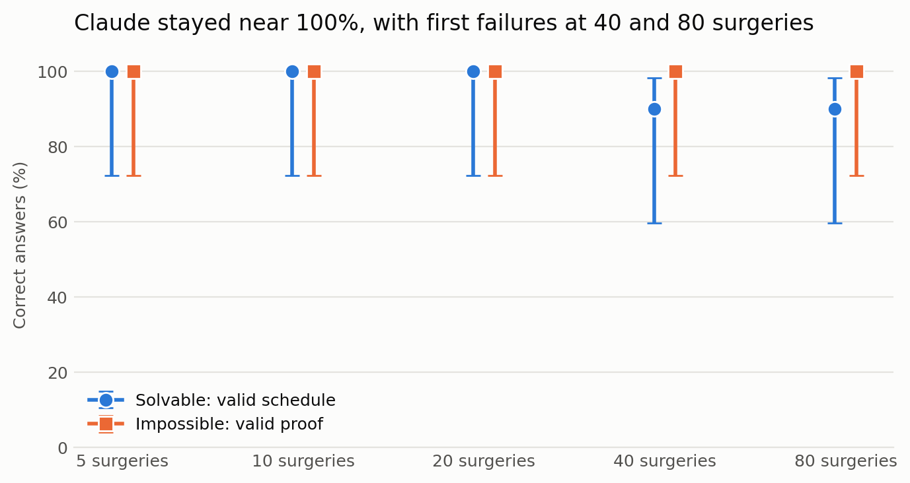
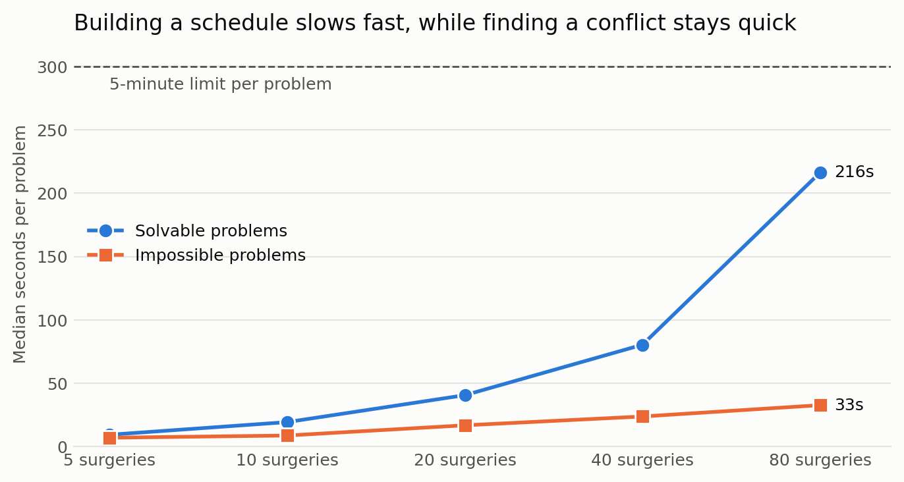

# Claude alone on harder surgery problems

**Date:** 1 November 2026. **Model:** `claude-opus-5-5` at `high` effort, using the prompt from the first study. **No tools or solver were used.** The solver comparison is being handled by other team members.

**Status:** preliminary. The team has not yet reviewed this dataset or setup.

## The result in one minute

Claude got **98 of 100** harder problems fully correct, on schedules of up to 80 surgeries. It only started to fail at 40 surgeries and above.

1. **The two failures were different.** At 40 surgeries it double-booked a surgeon. At 80 surgeries it ran out of the 5-minute limit.
2. **Time is the clearest warning sign.** A typical solvable 80-surgery problem took 3.6 minutes, about 24 times longer than a 5-surgery one.
3. **Spotting impossible problems stayed easy.** Claude proved all 50 impossible, but this dataset only contains one simple kind of impossibility, so don't read too much into it.
4. **A small error rate still matters.** The double-booking looked like a complete, confident answer. Without an independent checker, nobody would have noticed it.

This doesn't show that Claude can replace a solver. It shows that Claude handled these problems well, one attempt each, when every rule was written out clearly.

## Words used in this report

| Word | Plain meaning |
|---|---|
| Solvable | A valid schedule exists. |
| Impossible | No valid schedule can exist. |
| Valid schedule | A schedule that passes every rule when checked by the independent checker. |
| Valid proof | A correct explanation of which two surgeries can never both fit. |
| Fully correct | Claude gave the right decision and backed it with a valid schedule or proof. |
| Right yes/no decision | Claude said solvable or impossible correctly, even if its schedule was then wrong. |
| Token | The unit AI usage is measured in, roughly three-quarters of a word. |
| 95% interval | The range the true success rate plausibly falls in, given how little data there is. |

## The dataset

`fixtures/hard-synthetic-v1` has **100 problems: 10 solvable and 10 impossible at each of 5 sizes** (5, 10, 20, 40 and 80 surgeries).

| Feature | First dataset | This dataset |
|---|---|---|
| Surgeries per problem | 2 or 3 | 5 to 80 |
| Gaps between surgeries | None | Yes |
| Room breaks | None | Yes, each room has a lunch break |
| Surgery lengths | Short, invented numbers | 11 to 185 minutes, from real hospital data |
| The conflicting pair | Always A and E, shown in the text | Different random surgery IDs each time |

**How the answers are known.** A program first creates a valid schedule, then writes the rules around it. Each impossible problem is a copy of a solvable one with one deadline moved earlier, by as little as 1 minute. The two can look almost identical, so Claude has to reason it out.

**How the answers were checked.** The independent checker accepted every planted schedule and proof. As a separate check, the project's simple solver never contradicted an answer. Within its limits, it found schedules for only 8 of the 50 solvable problems, so these problems are far harder than the first set. It should not be read as a fair solver comparison.

**Surgery lengths.** They are 20 representative values from a study of about 205,000 recorded surgeries in German hospitals (Korzhenevich, Zander and Bialas, 2022, [doi:10.5281/zenodo.7147921](https://doi.org/10.5281/zenodo.7147921), CC BY 4.0).

## How correct was Claude?

| Surgeries | Fully correct | Solvable: valid schedule | Impossible: valid proof | Right yes/no decision | Median output tokens |
|--:|---|---|---|---|--:|
| 5 | 20/20 | 10/10 | 10/10 | 20/20 | 732 |
| 10 | 20/20 | 10/10 | 10/10 | 20/20 | 1,441 |
| 20 | 20/20 | 10/10 | 10/10 | 20/20 | 3,314 |
| 40 | 19/20 | 9/10 | 10/10 | 20/20 | 6,476 |
| 80 | 19/20 | 9/10 | 10/10 | 19/20 | 15,779 |



**How to read this.** Dots are scores and lines are uncertainty. With 10 problems per dot, the lines are long. So this chart shows failures beginning, but it can't tell you whether 80 surgeries is really harder than 40. Across all 100 problems, the plausible overall rate is about 93% to 99%.

## How long did Claude take?

| Surgeries | Median time, solvable (s) | Median time, impossible (s) | Slowest run (s) |
|--:|--:|--:|--:|
| 5 | 9 | 7 | 14 |
| 10 | 19 | 9 | 25 |
| 20 | 41 | 17 | 74 |
| 40 | 80 | 24 | 123 |
| 80 | 216 | 33 | 300 |



**How to read this.** The size doubles at each step. Solvable problems took about twice as long at each step up to 40, then about 2.7 times as long from 40 to 80. Impossible problems grew slowly, because Claude could stop once it found the conflict. A full schedule has to place every surgery.

## What went wrong

| Size | Problem | What happened | Type of failure |
|--:|---|---|---|
| 40 | `hard-n40-05-8ceb0d3edb` | One surgeon's operation ended at minute 899, but their next one started at minute 889 in another room. That is a 10-minute double-booking. | **A real mistake** |
| 80 | `hard-n80-00-a752c44c58` | Claude didn't finish within the 5-minute limit, so there was no answer to mark. | **Ran out of time** |

The double-booked schedule was otherwise complete, with all 40 surgeries listed. Claude still chose the right decision (solvable), which is why that column shows 20/20 at size 40. The answer was still unusable.

The timeout comes from a limit this study set, not from Claude. Two of the 80-surgery runs took over 4 minutes, so a longer limit might have rescued this one. That wasn't tested.

## Is this result believable?

The answers were scored by the same independent checker that rejected all 640 tampered answers in the first study, and it caught the double-booking here. Each problem again ran in an empty folder with no tools, and the answers were stored separately.

## Limitations

| Limitation | Why it matters |
|---|---|
| Only 10 solvable and 10 impossible problems per size | Small differences between sizes can't be trusted. |
| One attempt per problem | We don't know how consistent Claude is at these sizes. A failure might not repeat, and a success might not either. |
| One kind of impossibility | Every impossible problem comes from one clashing pair. Real problems can be impossible because the whole day is overbooked, which would be much harder to prove. |
| Very regular wording | Every rule is written out exactly. Real requests are messy, so this is close to a best case. |
| Any valid schedule counts | Real hospitals want the best schedule, with less overtime and waiting. That wasn't tested. |
| A planted answer always exists | Real schedules can be tighter, and these problems may be easier than random ones of the same size. |
| Average surgery lengths | Real operations overrun. There are also no emergencies or cancellations. |
| 5-minute limit | One failure depends directly on this choice. |
| One model at one setting | Other models or effort levels may differ. |

## What this means for the project

- **For your report:** Claude alone is much stronger than the first study suggested, but it can still produce a confident answer that breaks a rule. That supports independently checking any AI schedule, including for the Responsible AI section.
- **For your teammates:** this dataset is ready for the solver comparison. It tests whether a solver prevents errors like the double-booking, and how time compares. The project's simple solver struggled here, so a proper solver like OR-Tools is needed.
- **Most useful next tests:** repeat sizes 40 and 80 several times, then add overbooked days and messier wording.

## Reproducing this study

```bash
python3 -m study.hard_dataset                               # refuses to overwrite the dataset
python3 -m study.run_hard --size 40 --budget 5              # calls the model; existing results are kept
python3 -m study.hard_report                                # rebuilds tables and charts; needs matplotlib
```

Runs are saved in `study/results/hard-n05` to `hard-n80`. `hard-n40-partial-usage-limit` is an earlier run stopped by a usage limit. It's kept for traceability and isn't used in these results.

| Surgeries | Estimated usage at list price (USD) |
|--:|--:|
| 5 | 0.61 |
| 10 | 0.94 |
| 20 | 1.84 |
| 40 | 3.48 |
| 80 | 7.28 |
| Interrupted run | 0.67 |
| **Total** | **14.82** |

These amounts show how much usage each run needed. On a Pro plan, they count against your allowance and aren't separate charges.

## AI disclosure for the report

The dataset generator, evaluation code, charts and this document were produced by Claude Code under a team member's direction, and the model being tested is also Claude. State this in your report, and make sure each team member understands the work.
