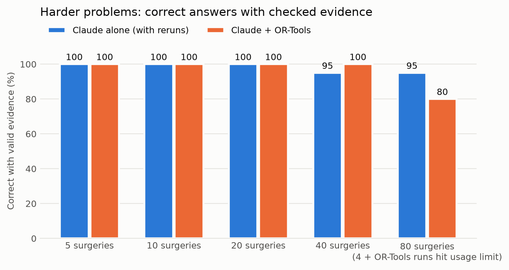
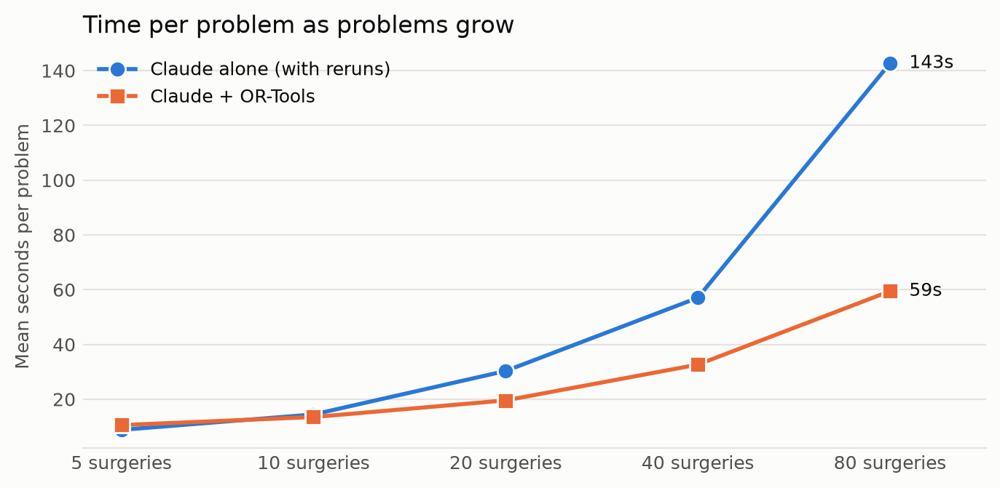

# Claude with and without the OR-Tools solver

**Status:** preliminary, for team review. Scored with [`evaluation-framework.md`](evaluation-framework.md): every planned run stays in the denominator.
**Model:** `claude-opus-5-5`, high effort, frozen v3 prompt, via the Claude Code CLI. **Solver:** OR-Tools CP-SAT 9.15 (`study/ortools_solver.py`).
**Rerun the scoring:** `.venv/bin/python -m study.ortools_report` (needs `ortools` and `matplotlib`; makes no model calls).

## The short answer

- **48-problem set:** Claude alone, Claude + simple solver and Claude + OR-Tools all scored 24/24 on the final test. The set is too easy to separate them.
- **100 harder problems:** every Claude + OR-Tools run that reached Claude was right, **96 of 96**. The framework score is **96/100**, because 4 runs at 80 surgeries hit the account usage limit.
- **The solver fixed Claude's one real mistake:** at 40 surgeries Claude alone double-booked a surgeon, while Claude + OR-Tools got all 20 right.
- **Bigger problems were faster with the solver:** at 80 surgeries, about 60 seconds per problem against 143 for Claude alone. The solver route used more tokens, though.

The prompt is identical in both setups. Only the solver behind Claude's tool changed, from the project's simple search to OR-Tools.

## 48-problem set: final test (8 problems × 3 runs)

| Measure | Claude alone | Claude + simple solver | Claude + OR-Tools | OR-Tools on gold |
|---|--:|--:|--:|--:|
| Evidence-backed success | 24/24 | 24/24 | 24/24 | 8/8 |
| UNKNOWN, parse, timeout, provider or tool errors | 0 | 0 | 0 | 0 |
| Seconds per case (mean) | 4.9 | 9.7 | 9.8 | under 0.01 |
| Tokens per case (mean) | 2,130 | 6,159 | 6,165 | 0 |

The train (32/32) and validation (8/8) splits were also perfect for both Claude setups, and every run paired up as "both correct". Claude's translation matched the intended problem exactly every time, so there were no translation, solver or output failures.

## 100 harder problems

| Measure | Claude alone, first attempt | Claude alone, with reruns | Claude + OR-Tools | OR-Tools on gold | Simple solver on gold |
|---|--:|--:|--:|--:|--:|
| Evidence-backed success | 64/100 | 98/100 | 96/100 | 100/100 | 52/100 |
| Feasible-schedule success | 32/50 | 48/50 | 48/50 | 50/50 | 6/50 |
| Certified-infeasible success | 32/50 | 50/50 | 48/50 | 50/50 | 46/50 |
| Provider errors (usage limit) | 36/100 | 0/100 | 4/100 | 0 | 0 |
| Timeouts | 0/100 | 1/100 | 0/100 | 0 | 0 |
| Seconds per case (mean) | 13.5 | 50.7 | 27.1 | 0.4 | 0.4 |
| Tokens per case (mean) | 4,872 | 10,038 | 17,443 | 0 | 0 |

| Surgeries | Claude alone, with reruns | Claude + OR-Tools | Seconds: alone / + OR-Tools | Tokens: alone / + OR-Tools |
|--:|--:|--:|--:|--:|
| 5 | 20/20 | 20/20 | 9 / 11 | 2,676 / 6,840 |
| 10 | 20/20 | 20/20 | 14 / 13 | 3,777 / 8,801 |
| 20 | 20/20 | 20/20 | 30 / 20 | 6,753 / 13,295 |
| 40 | 19/20 | 20/20 | 57 / 33 | 12,278 / 22,438 |
| 80 | 19/20 | 16/20 (16 of 16 completed) | 143 / 59 | 25,479 / 35,839 |

Pairing the same problems: 95 both correct, 3 only Claude alone (the 4 usage-limit runs, minus one problem Claude alone also missed), 1 only Claude + OR-Tools (the double-booked schedule) and 1 neither.

**What the numbers mean:**
- **OR-Tools is the right solver.** Given the true problem it solved all 100, while the simple search found only 6 of the 50 schedules.
- **Claude translated almost perfectly.** Its solver input matched the intended problem exactly in 94 of 96 completed runs; the other 2 differed in ways that still gave a valid schedule.
- **The solver removes Claude's scheduling mistakes and scales better in time.** Claude only has to translate and copy the answer, instead of working out a large schedule itself.
- **It costs more tokens** (about 1.4–2.6× per problem), because Claude writes out the whole problem for the solver and then copies the schedule back.

## Limits

- **Usage-limit failures count.** 4 of 20 Claude + OR-Tools runs at 80 surgeries never reached Claude, and Claude alone's first attempts lost 36. The framework counts them, so compare the completed-run numbers when judging the model.
- **The failure split labels the 4 usage-limit runs "translation error",** because its three categories don't cover provider errors. They are provider errors, not translations.
- **Each harder problem ran once,** with one model and one prompt, through the CLI rather than a direct API call.
- **Tidy problems:** clean wording, one kind of impossibility, and feasibility only, with no optimisation.
